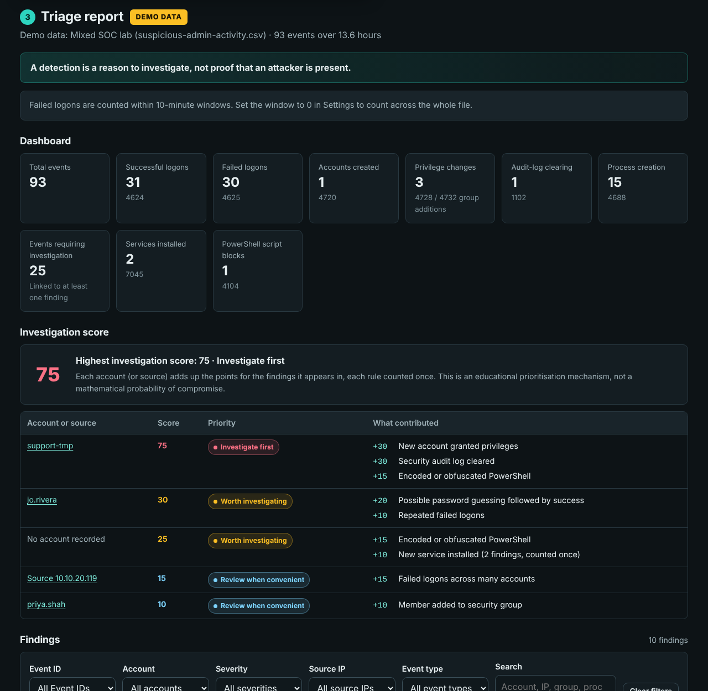
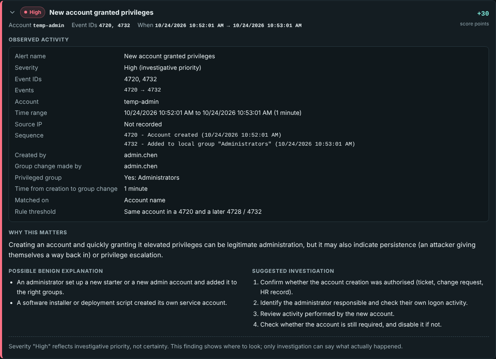
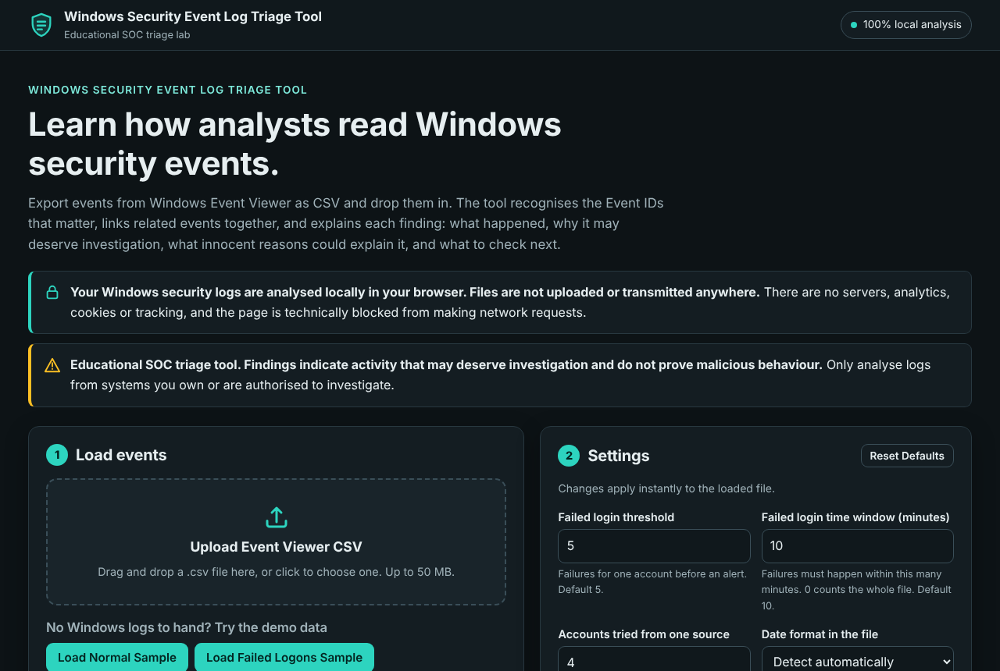
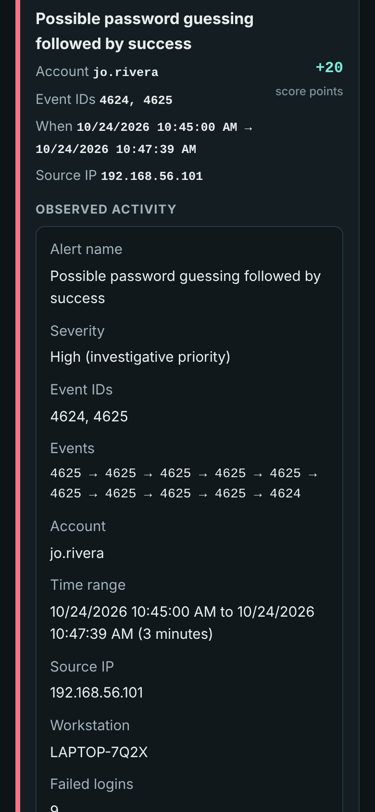
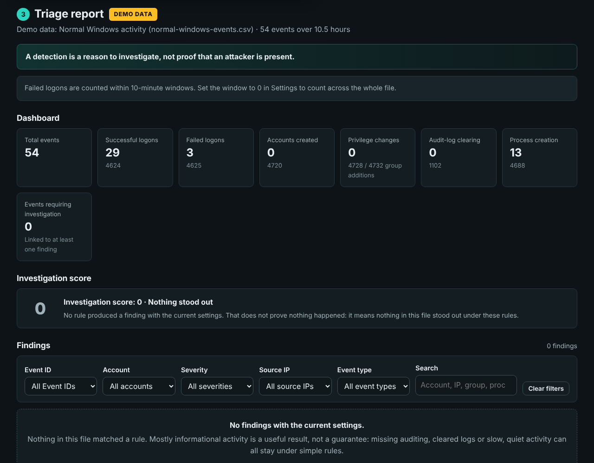
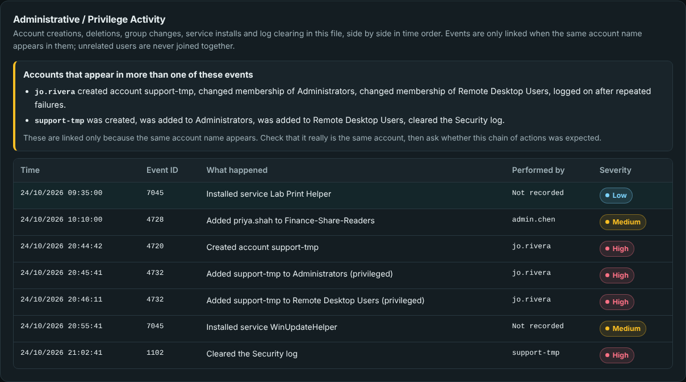
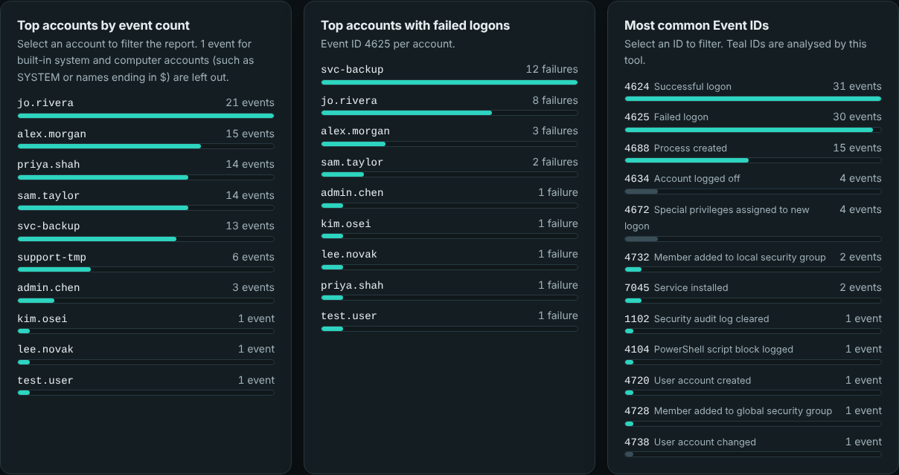

# Windows Security Event Log Triage Tool

An educational, browser-based tool that turns a Windows Event Viewer CSV export into an easy-to-read **SOC-style triage report**. It recognises the security Event IDs that matter, links related events together, and explains every finding the way an analyst would: what happened, why it may deserve investigation, what innocent reasons could explain it, and what to check next.

> **One security event rarely tells the entire story. Analysts build context by correlating multiple events.**



- 100% local: your logs never leave your browser
- Recognises 10 key Event IDs (4624, 4625, 4688, 4720, 4726, 4728, 4732, 1102, 4104, 7045)
- Correlates events: failures followed by success, a new account that gains admin rights, one source trying many accounts
- An investigation score where every point is shown, not a fake "93% malicious"
- Built-in demo data for presentations, so it works on any computer, including a Mac
- Plain HTML, CSS and JavaScript: nothing to install

---

## Contents

1. [What it does](#what-it-does)
2. [Project purpose](#project-purpose)
3. [What Windows event logs are](#what-windows-event-logs-are)
4. [What SOC triage means](#what-soc-triage-means)
5. [Run it locally on a Mac](#run-it-locally-on-a-mac)
6. [Using this tool from a Mac: real Windows logs](#using-this-tool-from-a-mac-real-windows-logs)
7. [Export suitable Windows event data](#export-suitable-windows-event-data)
8. [Supported Event IDs](#supported-event-ids)
9. [Detection rules](#detection-rules)
10. [Correlation rules](#correlation-rules)
11. [Default thresholds](#default-thresholds)
12. [Investigation score](#investigation-score)
13. [Sample datasets and demo walkthrough](#sample-datasets-and-demo-walkthrough)
14. [False positives](#false-positives)
15. [Limitations](#limitations)
16. [Privacy architecture](#privacy-architecture)
17. [Security design](#security-design)
18. [Accessibility](#accessibility)
19. [Educational use](#educational-use)
20. [Future improvements](#future-improvements)
21. [Project structure](#project-structure)

---

## What it does

1. You export security events from Windows Event Viewer as a CSV file (or click a demo button).
2. You drop the CSV into this page.
3. The page reads the file **inside your browser**, works out each event's account, source IP, logon type, group and process, and runs a set of explainable rules.
4. You get a report with:
   - **Dashboard:** total events, successful and failed logons, accounts created, privilege changes, audit-log clearing, process creation and events requiring investigation.
   - **Investigation score** per account (or source IP), listing exactly which findings added points.
   - **Findings**, each with severity, Event IDs, account, time range, source IP and workstation, observed activity, why it matters, a possible benign explanation and suggested investigation steps.
   - **Administrative / Privilege Activity:** account creations, deletions, group changes, service installs and log clearing side by side, plus the accounts that appear in more than one of them.
   - **Charts:** top accounts by event count, top accounts with failed logons, most common Event IDs.
   - **Timeline of noteworthy activity** in time order.
   - **Filters** by Event ID, account, severity, source IP and event type, plus a search box.
   - **Event explorer** showing every event with its key details and the original description.
   - **Rule coverage**, showing which rules had the events they needed in this file.



## Project purpose

This project teaches cybersecurity students how a SOC analyst **triages** Windows security events: identifying what happened, connecting related events, and deciding what deserves a closer look.

It deliberately does **not** claim that any single Windows event proves a system has been compromised. Every finding is framed as a reason to investigate, alongside the everyday reasons the same events appear. The educational value and explainability matter more than looking advanced.

## What Windows event logs are

Windows keeps a diary of what happens on a computer. Each entry is an **event** with a time, a source and an **Event ID**: a number that says what kind of thing happened. For example, 4624 means someone logged on successfully and 4625 means a logon failed.

Security-relevant events live mostly in the **Security** log. Others live in the **System** log (for example 7045, a new service) and the **PowerShell Operational** log (4104, script block logging). Which events appear depends on the computer's **audit policy**: if auditing for something is switched off, those events are simply never written.

## What SOC triage means

A Security Operations Centre (SOC) receives far more alerts than it can investigate in depth. **Triage** is the first pass: quickly working out what each alert is, how it relates to other activity, and whether it needs escalating, watching or closing as benign. This tool walks through that thinking for Windows authentication and privilege events.

## Run it locally on a Mac

The tool is just a web page, so it runs in any modern browser on macOS (also Windows, Linux, ChromeOS, iPad). Nothing needs to be installed.

1. Download the project (on GitHub: **Code > Download ZIP**). Safari usually unzips it automatically into your **Downloads** folder; if not, double-click the ZIP.
2. Open the unzipped folder in **Finder**.
3. Double-click **`index.html`**. It opens in your default browser.
   - To choose a browser, right-click (or Control-click) `index.html` and pick **Open With > Google Chrome** (or Safari, Firefox, Edge).
4. Click **Load Mixed SOC Sample** to see a full report straight away.

It works offline. To host it later, upload the folder to any static host (for example GitHub Pages); there is no server code.



It also works on phones and tablets:



## Using this tool from a Mac: real Windows logs

**macOS does not have Event Viewer.** The Mac equivalent is the **Console** app (and the `log` command), which reads Apple's "unified log". It records very different things and has **no Windows Event IDs**, so a Mac cannot produce the files this tool reads. That is fine: SOC work is largely about Windows endpoints and Active Directory, so learning Windows events is the more valuable skill.

You have three options:

### Option 1: Use the built-in demo data (no Windows needed)

The five demo buttons load realistic, fictional Windows logs that cover every rule. This is all you need for learning and for demonstrations.

### Option 2: Run Windows in a free virtual machine

A virtual machine (VM) runs Windows in a window on your Mac. Your Mac is not changed.

1. Install **UTM** (free) from [mac.getutm.app](https://mac.getutm.app). It supports Apple Silicon (M1, M2, M3, M4) and Intel Macs.
2. Download **Windows 11 for Arm** (Apple Silicon) or the normal Windows 11 ISO (Intel) from Microsoft. Microsoft also offers time-limited evaluation copies, which are fine for a lab. UTM's website has a step-by-step Windows 11 guide.
   - Alternatives: VMware Fusion (free for personal use) or Parallels Desktop (paid, with a free trial).
3. Inside the Windows VM, open **Event Viewer** and follow [Export suitable Windows event data](#export-suitable-windows-event-data).
4. Move the CSV to your Mac with a UTM **shared folder**, or drag and drop if your VM supports it. Then open `index.html` on your Mac and upload the CSV. (You can also just open the tool inside the VM's browser.)

**Generate safe test events inside your own VM only.** In an administrator Command Prompt in the VM:

```bat
:: Failed logons: lock the screen (Windows key + L) and type a wrong password 6 times, then log in.

:: Account created and added to Administrators (creates 4720 and 4732)
net user labtest LabOnly!2026 /add
net localgroup Administrators labtest /add

:: Clean up afterwards (creates 4726)
net user labtest /delete

:: Clear the Security log (creates 1102). Export first if you want to keep the earlier events!
wevtutil cl Security
```

To also record process creation (4688) with command lines, and PowerShell script blocks (4104), run this once in an administrator PowerShell in the VM:

```powershell
auditpol /set /subcategory:"Process Creation" /success:enable
reg add "HKLM\Software\Microsoft\Windows\CurrentVersion\Policies\System\Audit" /v ProcessCreationIncludeCmdLine_Enabled /t REG_DWORD /d 1 /f
reg add "HKLM\SOFTWARE\Policies\Microsoft\Windows\PowerShell\ScriptBlockLogging" /v EnableScriptBlockLogging /t REG_DWORD /d 1 /f
```

Only do this on a VM or computer you own.

### Option 3: Public practice datasets

Security researchers publish recorded Windows logs for training, for example the **EVTX-ATTACK-SAMPLES** and **OTRF Security-Datasets** projects on GitHub. They are usually `.evtx` files, so open them in Event Viewer inside your Windows VM (**Action > Open Saved Log**) and save them as CSV. Treat them as lab material only.

### Future idea: a macOS logs mode

A later version could read exported macOS unified logs (for example from `log show`) and teach the Mac equivalents, such as authentication and `sudo` activity. It is listed under [Future improvements](#future-improvements) and is not part of Version 1.

## Export suitable Windows event data

### Method 1: Event Viewer (easiest)

1. Open **Event Viewer** (press the Windows key, type *Event Viewer*, choose **Run as administrator**; the Security log needs admin rights).
2. Go to **Windows Logs > Security**.
3. Optional but recommended: click **Filter Current Log...** and type the IDs you want in the *&lt;All Event IDs&gt;* box, for example `4624,4625,4720,4726,4728,4732,1102,4688`. You can also choose a time range.
4. Click **Save Filtered Log File As...** (or **Save All Events As...**).
5. Set *Save as type* to **CSV (Comma Separated) (\*.csv)** and save.
6. Upload the CSV into this tool.

What to expect from this file (the tool handles all of this automatically):

- The headings are `Keywords` (or `Level`), `Date and Time`, `Source`, `Event ID` and `Task Category`. The **event description has no heading**: it is an extra, sixth column. That description holds the account name, source IP, logon type, group name and so on, so the tool reads those details out of the text.
- Events are listed **newest first**. The tool re-sorts them oldest first so it can see what happened before what.
- **Dates follow your Windows region setting** (for example `10/24/2026 9:15:02 AM` in the US or `24/10/2026 09:15:02` in the UK and India). The tool detects the order where it can and lets you choose it in Settings when every day in the file is 12 or less.

To include PowerShell (4104) and service (7045) events in one file, create a **Custom View** (Action > Create Custom View) that covers the **Security**, **System** and **Microsoft-Windows-PowerShell/Operational** logs, then save that view as CSV.

### Method 2: PowerShell (cleaner, unambiguous dates)

In an administrator PowerShell:

```powershell
Get-WinEvent -FilterHashtable @{ LogName = 'Security'; Id = 4624,4625,4688,4720,4726,4728,4732,1102 } -MaxEvents 5000 |
  Select-Object @{n='TimeCreated'; e={ $_.TimeCreated.ToString('o') }}, Id, LevelDisplayName, ProviderName, MachineName, TaskDisplayName, Message |
  Export-Csv -Path "$env:USERPROFILE\Desktop\security-events.csv" -NoTypeInformation -Encoding UTF8
```

The `ToString('o')` part writes times in ISO 8601 format (`2026-10-24T09:15:02...`), which avoids any day/month confusion. The **PowerShell export format** demo button shows a file made this way.

Files that the tool rejects with a clear message: raw `.evtx` logs, Excel workbooks, empty files, files without an Event ID column, and files over 50 MB.

## Supported Event IDs

| Event ID | Name | In plain English | Log | Default severity |
|---|---|---|---|---|
| 4624 | Successful logon | An account logged on. Normal on its own; important as context. | Security | Informational |
| 4625 | Failed logon | A logon failed. One is usually a typo; many deserve a look. | Security | Low |
| 4688 | Process created | A program started. Shows the program, parent and command line (if enabled). Off by default. | Security | Informational |
| 4720 | User account created | A new user account was created. | Security | Medium |
| 4726 | User account deleted | A user account was deleted. | Security | Low |
| 4728 | Member added to global security group | An account was added to a domain-wide security group. | Security | Medium |
| 4732 | Member added to local security group | An account was added to a group on this computer, such as Administrators. | Security | Medium |
| 1102 | Security audit log cleared | Someone cleared the Security log. | Security | High |
| 4104 | PowerShell script block logged | PowerShell recorded the script it ran. | PowerShell Operational | Informational |
| 7045 | Service installed | A new Windows service was installed. | System | Low |

About 30 other common IDs (such as 4634 logoff, 4672 special privileges, 4740 account locked out) are **named** in the event explorer so beginners know what they are, but no rules run on them.

**What the tool reads from each description:**

- **4624 / 4625:** the account from *New Logon* or *Account For Which Logon Failed* (not the *Subject*, which is usually the computer itself), logon type, source network address, workstation name, and for 4625 the failure reason and status code (translated into plain English, for example `0xC000006A` = wrong password for a valid user name).
- **4720 / 4726:** the new or deleted account, and who did it (*Subject*).
- **4728 / 4732:** the member, the group name and who made the change. Local group events often show the member as `-` with only a Security ID, so the tool matches on the Security ID too.
- **1102:** who cleared the log.
- **4688:** process name, parent process, command line and account.
- **4104:** the script text.
- **7045:** service name, program path, start type and account.

## Detection rules

Single-event rules. None of them claims compromise.

| Rule | Triggers on | Severity | Points |
|---|---|---|---|
| User account created | Each 4720 not already part of a correlation | Medium | +5 |
| Member added to security group | Each 4728 / 4732 not already part of a correlation | Medium, or **High** if the group looks privileged | +10, or +25 if privileged |
| User account deleted | Each 4726 | Low, or Medium if the account was also created in this file | +5 |
| Security audit log cleared | Every 1102 | High | +30 |
| New service installed | Each 7045 | Low, or Medium if the program is in a user-writable folder or runs a script host | +10 |
| Encoded or obfuscated PowerShell | A 4104 script block or 4688 command line with clues such as `-EncodedCommand`, `FromBase64String`, a very long Base64 string, many backtick escapes or `[char]` codes | Medium | +15 |

**Privileged groups** are built-in groups with administrative or remote access rights (Administrators, Domain Admins, Enterprise Admins, Schema Admins, Account Operators, Backup Operators, Server Operators, Print Operators, Remote Desktop Users, Remote Management Users, Group Policy Creator Owners, DnsAdmins, Hyper-V Administrators and similar), or any group whose name contains "admin". The finding says which reason applied.

For `-EncodedCommand`, the tool also **decodes** the Base64 and shows the real command as plain text, so students can see what was hidden. It is displayed, never run.

## Correlation rules

This is the heart of the project: the tool does not look at each event alone.

| # | Rule | How it works | Severity | Points |
|---|---|---|---|---|
| 1 | **Repeated failed logons** | Groups 4625 events by account. If one account has at least the threshold (default 5) within the time window (default 10 minutes), it raises a finding. | Medium | +10 |
| 2 | **Possible password guessing followed by success** | For each 4624, counts the same account's 4625 failures since its previous success (and within the window). At or above the threshold, it raises a finding. | **High** if the success came from the same source IP (or workstation) as the failures, otherwise Medium | +20 |
| 3 | **New account granted privileges** | A 4720 followed later in the file by a 4728 or 4732 for the **same account**, matched by account name or Security ID. The single-event findings for those events are folded into this one. | **High** if any group is privileged, otherwise Medium | +30 |
| 4 | **Security log cleared** | Every 1102. | High | +30 |
| 5 | **Administrative / Privilege Activity** | A dedicated section listing every 4720, 4726, 4728, 4732, 7045 and 1102 in time order. Accounts that appear in more than one of these (as the person doing it or the account affected), or that also logged on after repeated failures, are listed together. Accounts are linked **only by matching names**; unrelated users are never joined. | (summary) | (none) |
| extra | **Failed logons across many accounts** | One source IP failing against at least 4 different accounts within the window: the password spraying pattern. Linked by IP address only. | Medium | +15 |

In the Mixed SOC sample, section 5 shows the full story: jo.rivera logs on after 8 failures, creates `support-tmp`, adds it to Administrators, and `support-tmp` later clears the Security log.

## Default thresholds

| Setting | Default | Notes |
|---|---|---|
| Failed login threshold | 5 | Used by rules 1 and 2. |
| Failed login time window | 10 minutes | Failures must fall within this many minutes. **0 counts the whole file.** Switched off automatically if the file has no readable timestamps. |
| Accounts tried from one source | 4 | Used by the password spraying rule. |
| Date format | Detect automatically | Choose Month/day/year or Day/month/year if the file is ambiguous. |

**Security thresholds vary by environment. These values are educational defaults rather than universal SOC detection rules.** Settings are saved in your browser (only the numbers, never your logs) and **Reset Defaults** restores them.

Try this: load the Mixed SOC sample and set the window to 0. A new finding appears for `svc-backup`, whose stale password fails every 5 minutes for an hour: too slow for a 10-minute window, but obvious across the whole file. Changing one setting changes what an analyst sees.

## Investigation score

Each finding adds the points shown to the account it is about (or to "Source x.x.x.x" for the spraying rule). Each rule counts once per account, so ten identical findings do not inflate the score. The score table lists every contribution.

| Score | Label |
|---|---|
| 0 | Nothing stood out |
| 1-19 | Review when convenient |
| 20-49 | Worth investigating |
| 50+ | Investigate first |

This is an **educational prioritisation mechanism, not a mathematical probability of compromise.** There are no "93% malicious" numbers anywhere.

## Sample datasets and demo walkthrough

All names, computers and IP addresses are fictional; IPs use private ranges (10.x, 192.168.x). The same files are in `samples/` and built into `js/samples.js` so the buttons work when the page is opened straight from disk.

| Button | File | What it contains | Expected result |
|---|---|---|---|
| Load Normal Sample | `normal-windows-events.csv` | A day of logons, logoffs, normal programs, a routine account change; two users mistype a password once or twice | No findings: mostly informational |
| Load Failed Logons Sample | `failed-logons.csv` | sam.taylor fails 7 times in 3 minutes from one IP, no success | Repeated Failed Logons |
| Load Password Guessing Sample | `password-guessing.csv` | jo.rivera fails 9 times, then logs on by RDP from the same IP | Possible Password Guessing Followed By Success (High) + Repeated Failed Logons |
| Load Privilege Escalation Sample | `account-persistence.csv` | temp-admin created (4720) and added to Administrators (4732) a minute later | New Account Granted Privileges (High) |
| Load Mixed SOC Sample | `suspicious-admin-activity.csv` | Password spraying, slow stale-credential failures, password guessing then success, new admin account, encoded PowerShell, a service in a user folder, a benign group change, log cleared | Several correlated findings, including Security Audit Log Cleared |
| PowerShell export format | `powershell-export.csv` | A Get-WinEvent export with ISO dates: normal admin PowerShell, a software install, and a deployment tool's encoded command | Shows the second file format, and a benign encoded command |
| Broken CSV | `malformed-example.csv` | No Event ID column and an unclosed quote | Safe, clear error message |
| HTML injection test | `security-test.csv` | Account names, groups and paths containing `<script>`, ``, etc. | Shown as plain text; nothing runs |



### Recruiter demo script

1. **Normal activity.** Load Normal Sample. Point out that the two mistyped passwords did not raise anything: mostly informational.
2. **Repeated failures.** Load Failed Logons Sample: *Repeated Failed Logons* for sam.taylor. Open it and read the benign explanation (an app with an old password).
3. **Failures, then success.** Load Password Guessing Sample: *Possible Password Guessing Followed By Success*, High because the success came from the same IP.
4. **New account, new privileges.** Load Privilege Escalation Sample: *New Account Granted Privileges*, 4720 → 4732.
5. **Log cleared.** Load Mixed SOC Sample: *Security Audit Log Cleared*. Then scroll to **Administrative / Privilege Activity** and show how jo.rivera and support-tmp connect the events.

Close with: *"The individual events matter, but the real value comes from understanding how they relate to one another."*





## False positives

Every finding lists a possible benign explanation, because most real alerts turn out to be ordinary activity:

- **Repeated failed logons:** a forgotten password, Caps Lock, a phone or mapped drive still using an old password after a password change, a service with stale credentials.
- **Failures followed by success:** the real user finally typing the right password.
- **Failed logons across many accounts:** a shared kiosk or terminal server, or a VPN or NAT gateway where many users share one IP address.
- **Account created / added to a group:** new starters, approved access requests, software installers creating service accounts.
- **Log cleared:** maintenance, troubleshooting, or a lab machine being reset.
- **New service:** installing drivers, antivirus, backup agents or management tools.
- **Encoded PowerShell:** management and deployment tools commonly send encoded commands (the PowerShell export sample shows one).

## Limitations

- **CSV exports differ between Windows configurations.** Columns, date formats and encodings vary by Windows version, region and export method. The parser tolerates common variations but cannot know every layout.
- **The description text is English-only.** Account and IP extraction relies on English labels such as "Account Name:". Exports from Windows set to another language will load, but most details and correlations will be missing.
- **Ambiguous dates.** If every day in the file is 12 or less, 03/04 could be 3 April or 4 March. The tool warns you and lets you choose.
- **Not every event has a source IP.** Local logons show `-` or `127.0.0.1`.
- **Logging configuration decides what you can see.** Process creation (4688) and PowerShell script block logging (4104) are off by default. Default logs can be small and overwrite older events.
- **Absence of an event does not prove the activity did not happen.** Auditing may be off, or the log may have been cleared or overwritten.
- **Accounts are linked by name.** Two different accounts with the same name on different computers would be treated as one; correlation needs the same account to appear in both events.
- **One file at a time, in the browser.** Correlation only works within one export, and very large files (over 50 MB or 200,000 events) are refused or trimmed.
- **This tool does not replace an EDR, SIEM or professional SOC platform.** It has no baselines, no threat intelligence and no view of other systems.
- **Detecting malicious behaviour requires context.** Windows Event IDs alone cannot determine intent.
- **No .evtx parsing** in Version 1.

## Privacy architecture

- **All analysis happens in your browser.** The file is read with the browser's FileReader and processed by local JavaScript.
- **Nothing is uploaded, stored remotely or sent to an AI provider, analytics platform or external API.** There is no server.
- **A Content Security Policy blocks all network connections** (`connect-src 'none'`), so even a bug could not send data anywhere. It also blocks any script or style that is not part of the project.
- **No analytics, tracking, cookies, advertising or telemetry.** No external fonts, scripts or images are loaded.
- **Files are not retained.** Closing or reloading the tab discards the data. The only thing saved is your settings (four numbers and the date format) in the browser's local storage.

## Security design

Uploaded CSV content is treated as **untrusted input**:

- Every value is inserted into the page with `textContent`, never `innerHTML`, so text such as `<script>` is displayed, not run. The **HTML injection test** sample proves this.
- The Content Security Policy forbids inline scripts, so even if markup slipped through, it could not execute.
- The CSV reader is hand-written and never evaluates content. Malformed files (unclosed quotes, missing columns, binary data, wrong encoding) fail safely with a plain-English message.
- Cell lengths, row counts and file size are capped to stop a huge or hostile file from freezing the browser.
- Invisible control characters are stripped from every value.

## Accessibility

- Semantic HTML: landmarks, headings in order, real tables with captions and column headers.
- Every control has a visible label; keyboard users can reach everything, and a "Skip to main content" link is provided.
- A clear focus outline on every interactive element.
- Severity is shown with text **and** colour, never colour alone. Colours meet WCAG AA contrast on the dark background.
- Live regions announce file status and finding counts to screen readers.
- Respects "reduce motion" and works on small screens without sideways scrolling.

## Educational use

Use it to learn or teach:

- What the core Windows security Event IDs mean and where to find them.
- Why a single event is rarely enough, and how analysts **correlate** authentication and privilege activity.
- How thresholds and time windows change what gets flagged, and why there is no universal "right" number.
- How false positives happen, and how to rule activity in or out with evidence.

Only analyse logs from systems you own or are authorised to investigate.

## Future improvements

Not implemented in Version 1:

- Raw `.evtx` parsing
- Sysmon support
- Deeper PowerShell 4104 analysis
- Process-tree visualisation
- MITRE ATT&CK mapping
- Richer timeline analysis
- Login time baselining (normal hours per user)
- Service creation detection improvements (4697, signed binary checks)
- Scheduled task monitoring (4698)
- Windows Defender event analysis
- Exportable incident report
- SIEM integration
- A macOS logs mode that reads exported unified logs from the Console app or `log show`

## Project structure

```
Windows-Event-Log-Triage-Tool/
├── index.html            The page: upload, demo buttons, settings, report, teaching sections
├── css/styles.css        Dark slate and teal theme, severity colours, layout
├── js/csv-parser.js      Reads the CSV: encodings, columns, the unnamed description column, dates
├── js/analyser.js        Reads details from each description and runs the rules and correlations
├── js/app.js             Upload, filters, settings, and safe drawing of the report
├── js/samples.js         The demo files, built in so the buttons work offline
├── samples/              The demo files as CSVs
└── docs/screenshots/     Images used in this README
```
